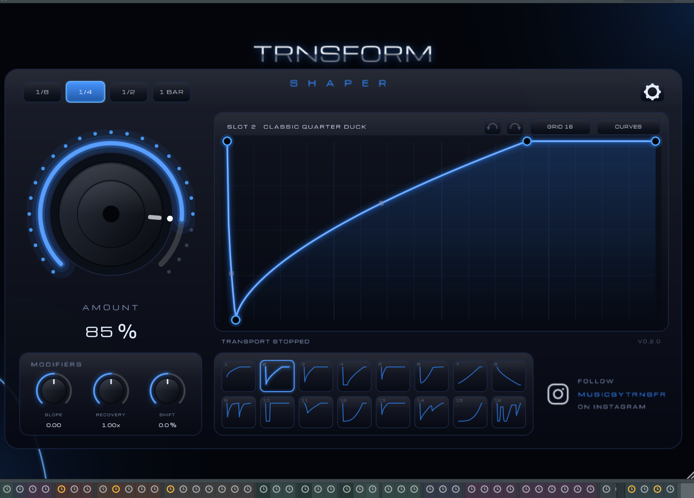

# TRNSFORM SHAPER

**A VST3 sidechain tool for rhythmic volume ducking, tempo-synced curves, and pumping effects in modern music production.**

TRNSFORM SHAPER gives producers control over rhythmic volume movement through editable curves and tempo-synchronised ducking.

## Features

- Tempo-synchronised sidechain-style volume ducking
- Editable volume curves
- 16 curve slots
- Shape controls for precise volume movement
- Save and reuse custom curves
- Project recall and host automation

## Download

**TRNSFORM SHAPER for Windows**

Requires 64-bit Windows and a DAW that supports VST3 plugins.

[Download TRNSFORM SHAPER](https://github.com/oliviervpxl/TRNSFORM-SHAPER-DOWNLOADS/releases/latest/download/TRNSFORM_SHAPER_Setup_x64.exe)

## Authors

Olivier Vleeschouwers & Bas Engelborghs

## License

TRNSFORM SHAPER is proprietary software. See [LICENSE](LICENSE) for the applicable usage and redistribution terms.

Third-party components remain subject to their respective licences.
